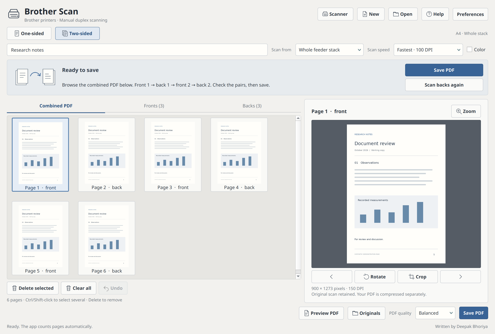

<p align="center"></p>

# Brother Duplex Scanner — Fast Two-Sided Scanning with One Manual Flip

**Scan both sides on Brother printers with a single-sided document feeder.** Scan all fronts, flip the stack once, scan all backs, and save one correctly ordered PDF.

**Written by Deepak Bhoriya.** Open-source Linux desktop software. MIT licensed.



[Dark theme](docs/images/dark-theme.png) · [Preferences](docs/images/preferences.png)

## Why this exists

The **Brother MFC-L2700DW** supports automatic duplex printing, but not automatic duplex scanning. This app provides a guided **manual duplex scanning** workflow using its single-sided feeder.

It scans the entire loaded stack without asking for page counts or ranges. A 100 DPI grayscale preset prioritizes speed; higher resolution and color remain available. Scanner warmup and mechanical movement still take time—“Fastest” is a preset, not a benchmark claim.

## Features

- **One-sided or two-sided** for the whole bundle.
- **One manual stack flip** between front and back passes; reverse-order backs are interleaved automatically.
- **Live thumbnails**, front/back galleries, zoom, and combined PDF preview.
- **Resume interrupted passes** without discarding completed scans.
- **Delete, clear, undo, rotate**, crop one page or crop all pages.
- **Independent scan and PDF quality**; captured originals remain unchanged.
- **Scanner selection**, manual SANE device IDs, editable driver profiles, and driver-option discovery.
- **Preferences:** A4 by default; A5, A6, Letter, Legal; light/dark themes; thumbnail size; default speed/color; PDF behavior.
- **Local storage only.** No account, cloud service, analytics, or document uploads.

## Requirements

- Linux with Python 3.10+.
- PyQt5 5.15+, Pillow 10+, and SANE's `scanimage` utility.
- An installed SANE backend or manufacturer scanner driver.
- An automatic document feeder for whole-stack scanning. Glass scanning is also available, one side at a time.

## Install and run

On Ubuntu/Debian:

```bash
sudo apt update
sudo apt install python3 python3-pyqt5 python3-pil sane-utils libqt5svg5
```

Clone the repository and run:

```bash
git clone https://github.com/dbhoriya/brother-manual-duplex-scanner.git
cd brother-manual-duplex-scanner
./scan.sh
```

For a virtual environment, install dependencies with `pip install -r requirements.txt` and run `python simple.py`. SANE and the scanner driver are still system dependencies. The launcher respects an activated virtual environment or `PYTHON=/path/to/python`.

## Two-sided scanning: one flip

1. Select **Two-sided** and **Whole feeder stack**.
2. Load the fronts in sheet order. Click **Scan all fronts**.
3. Flip/reload the bundle so the **back of the last sheet scans first**. Keep blank backs in the stack.
4. Click **Scan all backs**.
5. Check **Combined PDF**, then **Save PDF**.

Example: fronts `1, 3, 5` + backs `6, 4, 2` → PDF `1, 2, 3, 4, 5, 6`.

For one-sided documents, select **One-sided**, scan the stack, and save. This app scans documents; it does not implement printing.

## Scanner or driver not found?

Open **Scanner**:

1. Click **Find scanners**, or enter an exact SANE device ID manually.
2. Choose **Brother brscan**, **Standard SANE / AirScan**, or **Custom backend**.
3. Click **Read options from this driver** and verify the sources, color modes, and supported DPI.
4. Click **Use this scanner**.

**Selecting a profile does not install a driver.** If discovery finds nothing, install the backend for your exact model and check connectivity and permissions. See [driver setup](docs/DRIVERS.md).

## Preferences and quality

| Control | Choices |
|---|---|
| Scan speed | Fastest 100 DPI; Balanced 150 DPI; High detail 300 DPI; Maximum detail 600 DPI |
| Color | Grayscale by default; color at any speed |
| Paper | A4 default; A5, A6, Letter, Legal |
| PDF quality | Small file, Balanced, Best quality; independent of capture resolution |
| Appearance | Light/dark theme; small/medium/large thumbnails |

For a configured driver with a discrete DPI list, the app chooses the supported resolution nearest the requested preset. Previously scanned pages keep their captured dimensions and colors. Raw originals can be much larger than the compressed PDF.

## If scanning stops halfway

- Completed pages are saved automatically.
- Remove already-scanned sheets from the input stack and continue with the remaining sheets in the same order.
- Before starting backs, **Add more fronts** can extend an incomplete front pass.
- If back order is uncertain, **Scan backs again** restarts that whole pass while retaining original files.
- Missing or extra backs block two-sided PDF export. Counts alone cannot identify a skipped or double-fed sheet: inspect the previews.

See [usage and shortcuts](docs/USAGE.md) for editing, recovery, and paper-size details.

## Compatibility and limitations

- **Initial hardware verification:** Brother MFC-L2700DW, USB, Brother `brscan4`, 150 DPI glass scan.
- **Manual duplex, recovery, and other profiles:** automated tests with simulated scanners. A physical two-pass feeder test and additional models still need verification.
- Other Brother/SANE devices may work after profile configuration; universal compatibility is not claimed.
- Brother MFC-L2700DW scan width is capped at about 211.9 mm. Letter/Legal lose a narrow edge strip; Legal requires the feeder.
- No OCR, automatic deskew, PDF import, or automatic recognition of sheet order. PDFs contain compressed images.
- Linux only; Windows/macOS are not currently supported.

## Storage and privacy

Projects and original scans: `~/Scans/Studio/`. Scanner/preferences settings: `~/.config/brother-scan-studio/` (or `$XDG_CONFIG_HOME`). Deleting a page removes it from the document, not from disk. Closing ends the current workspace; each launch starts empty. Use **Open saved** to resume an older project.

No scans, personal settings, device IDs, logs, or backups are included in this repository. Review logs before attaching them to issues; they can contain local paths or scanner identifiers.

## Development

```bash
sudo apt install poppler-utils
QT_QPA_PLATFORM=offscreen python3 -m unittest test_audit test_scanner_setup test_preferences -v
```

Tests use a simulated scanner; they do not require or operate physical hardware. PDF checks use `pdfinfo` and `pdftoppm`. CI runs the same suite. See [CONTRIBUTING.md](CONTRIBUTING.md).

## License and attribution

Copyright © 2026 **Deepak Bhoriya**. Application code and original graphics are licensed under the [MIT License](LICENSE). PyQt5/Qt, Pillow, SANE, and manufacturer drivers retain their own licenses.

An independent community project, not affiliated with or endorsed by Brother Industries. Brother product names identify compatible or tested hardware.
